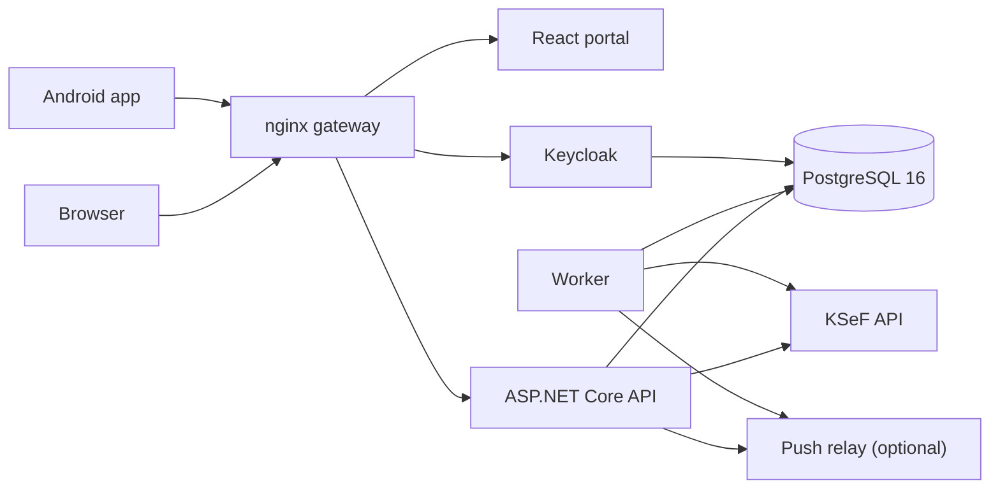

<p>
  <picture>
    <source media="(prefers-color-scheme: dark)" srcset="https://open-ksef.pl/img/mark-dark.svg">
    
  </picture>
</p>

# OpenKSeF

[](https://github.com/open-ksef/open-ksef/actions/workflows/ci.yml)
[](https://github.com/open-ksef/open-ksef/releases/latest)
[](LICENSE)

Invoices from Poland's National e-Invoice System (KSeF) on your own server: fetch received and sales invoices, see what is unpaid by due date, pay by QR code, issue VAT invoices.

`Kod źródłowy jest publicznie dostępny` (the source code is publicly available) under the [Elastic License 2.0](LICENSE). `Bez opłat za uruchomienie u siebie` (no fee to run it yourself). `Nie prowadzimy wersji hostowanej dla firm` (we run no hosted version for companies). `Niezależny projekt, niepowiązany z Ministerstwem Finansów` (an independent project, not affiliated with the Ministry of Finance).


The screenshot shows fictional data. The portal and the [documentation](https://open-ksef.pl/docs/intro) are in Polish.

## What it does

| Area | What you get |
|------|--------------|
| Sync | Background download of received and sales invoices from KSeF, every 4 hours by default, plus manual sync |
| Received invoices | Unpaid list by due date, line items, a paid flag kept in OpenKSeF, transfer details and a ZBP QR code for PLN invoices with an account number |
| Issuing | VAT invoices sent to KSeF from the portal, with XML, UPO and a PDF with KOD I. Services for foreign companies with foreign currency and the NBP rate. Limits: [what it does not do](https://open-ksef.pl/docs/wystawianie-faktur#ograniczenia) |
| Several companies | One account can hold several companies (NIPs), and users see only their own |
| Phone | Android app with push notifications: [open-ksef-mobile](https://github.com/open-ksef/open-ksef-mobile). `Android: plik APK na GitHubie, Google Play i iPhone jeszcze nie` (Android: an APK file on GitHub, not on Google Play or iPhone yet) |

## Who it is for

Small companies and accountants in Poland who want invoice data on their own server, and who have someone able to run Docker.

## Status

Beta: the API, database structure and configuration can change between releases. Invoice issuing was tested on the KSeF TEST environment. You are responsible for HTTPS, backups and updates of your instance. Read the [disclaimer](https://open-ksef.pl/docs/licencja#zastrzeżenie-dotyczące-danych-i-bezpieczeństwa) before you use real tax data.

## Install

New installations only. On an existing installation do not run these steps: they can overwrite the only copy of the encryption key. Follow the [upgrade procedure](docs/admin-setup.md#upgrade-from-v007-or-earlier).

You need Docker with Compose v2. Run this in a new directory:

```bash
curl -LO https://github.com/open-ksef/open-ksef/releases/latest/download/docker-compose.yml
openssl rand -base64 32
```

Store the printed key in a password manager. Then create `.env` next to `docker-compose.yml`, with your own passwords and the key:

```bash
POSTGRES_USER=openksef
POSTGRES_PASSWORD=change_me
KEYCLOAK_ADMIN=admin
KEYCLOAK_ADMIN_PASSWORD=change_me_too
ENCRYPTION_KEY=paste_the_generated_key
```

Start the stack:

```bash
docker compose up -d
```

Wait 30 to 60 seconds for Keycloak, then open <http://localhost:8080>. The portal redirects to the setup wizard at `/admin-setup`. Log in with `KEYCLOAK_ADMIN` and `KEYCLOAK_ADMIN_PASSWORD`. The wizard creates the `openksef` realm, the OAuth clients and your first account. Then add a KSeF token to the company, with invoice read and write permissions. A read-only token syncs invoices but cannot issue them.

Details: [setup wizard](docs/admin-setup.md), [site guide in Polish](https://open-ksef.pl/docs/instalacja/szybki-start).

### The encryption key

`ENCRYPTION_KEY` encrypts stored KSeF tokens and certificates (AES-256-GCM). It is not in the database, so database backups do not hold it. **If you lose it, every company must enter its token or certificate again.** `docker compose` refuses to run without it, and the wizard refuses an invalid value. Rotation: [rotate the key](docs/admin-setup.md#rotate-the-key).

### Ports

`docker-compose.yml` publishes five ports on all interfaces. All of them can be changed in `.env`:

| Port | Service | `.env` variable |
|------|---------|-----------------|
| 8080 | Gateway: portal at `/`, API at `/api/`, Keycloak at `/auth/` | `APP_HOST_PORT` |
| 8081 | API | `API_HOST_PORT` |
| 8082 | Keycloak | `KEYCLOAK_HOST_PORT` |
| 8083 | Portal | `PORTAL_WEB_HOST_PORT` |
| 5432 | PostgreSQL | `POSTGRES_HOST_PORT` |

From the internet, expose only the gateway, behind your own HTTPS reverse proxy. Set `APP_EXTERNAL_BASE_URL` when you reach the instance by another address than `http://localhost:8080`.

## Architecture



.NET 10, React 19, Keycloak 26. `src/OpenKSeF.Domain` holds entities and services, `src/OpenKSeF.Sync` the KSeF gateway and sync on top of [KSeF.Client](https://github.com/CIRFMF/ksef-client-csharp), `src/OpenKSeF.Api` and `src/OpenKSeF.Worker` the hosts. `src/OpenKSeF.PushRelay` is deployed separately: see [push notifications](docs/push-notifications-setup.md).

## Develop

See [CONTRIBUTING.md](CONTRIBUTING.md). You need a GitHub token with `read:packages` for the `KSeF.Client` NuGet feed.

```bash
dotnet build src/OpenKSeF.sln
dotnet test src/OpenKSeF.Api.Tests/OpenKSeF.Api.Tests.csproj
dotnet test src/OpenKSeF.Domain.Tests/OpenKSeF.Domain.Tests.csproj
cd src/OpenKSeF.Portal.Web && npm ci && npm test
```

## Links

- Documentation (Polish): [open-ksef.pl/docs/intro](https://open-ksef.pl/docs/intro)
- Releases: [github.com/open-ksef/open-ksef/releases](https://github.com/open-ksef/open-ksef/releases)
- Mobile app: [open-ksef-mobile](https://github.com/open-ksef/open-ksef-mobile)
- Documentation source: [open-ksef-doc](https://github.com/open-ksef/open-ksef-doc)
- Security reports: [SECURITY.md](SECURITY.md). Do not open a public issue.
- Contributing: [CONTRIBUTING.md](CONTRIBUTING.md)

## License

[Elastic License 2.0](LICENSE). You may use, modify and run OpenKSeF yourself. You may not provide it to third parties as a hosted or managed service. See [COMMERCIAL.md](COMMERCIAL.md).
